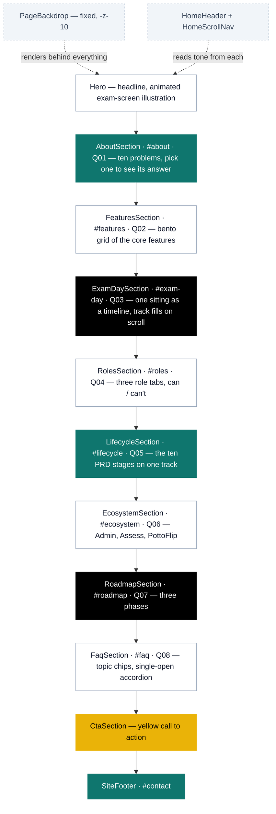
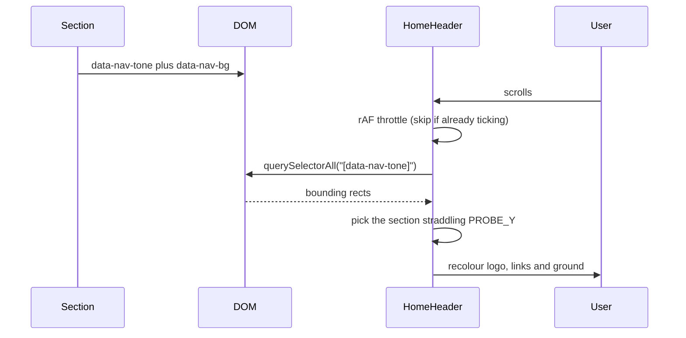

# Potto CBT — marketing site

The public site for **Potto CBT**, the computer-based testing platform of the
Potto Learning Suite: question banks, exam scheduling, a reliable exam room,
automatic marking of objective questions, results released on the school's
terms, and exam records with a full audit trail. It is one long homepage, no
other routes.

The content comes from the **Potto CBT PRD**, kept in
[`docs/PRD.md`](docs/PRD.md) — the roles, the core modules, the exam
lifecycle, the ecosystem integrations and the phased roadmap. The PRD is a
*proposed* specification, so anything it does not say is a gap for the team,
not a drafting choice (see Known gaps).

The site started as a copy of the PottoFlip site. It keeps the Potto **colour
palette**, the contour backdrop and the header's tone-probe mechanism, but its
look is its own — see "Design language" below.

> **Read [`AGENTS.md`](AGENTS.md) before writing code.** This is Next.js **16**,
> whose APIs and conventions differ from older versions. The guides in
> `node_modules/next/dist/docs/` are the authority, not memory or older tutorials.
>
> That file also carries the short list of **project rules** — the things that
> break when they are ignored. This README is the reasoning behind them.

---

## Stack

| Concern | Choice | Notes |
| --- | --- | --- |
| Framework | Next.js 16.3.1, App Router | Turbopack; the homepage prerenders static |
| UI | React 19.2 | the routes are Server Components; the homepage's sections are client components (`"use client"`) |
| Styling | Tailwind CSS v4 | CSS-first config in [`globals.css`](src/app/globals.css) — there is **no** `tailwind.config.js` |
| Animation | framer-motion 13 | scroll reveals, tabs, the scroll-linked exam-day track |
| Icons | `@hugeicons/react` + `@hugeicons/core-free-icons` | the house icon set |
| Fonts | Poppins (display and body), JetBrains Mono (numbers) | via `next/font/google` |

Every remaining dependency is used. `shadcn` and `tw-animate-css` are pulled in
by `globals.css` for their **token vocabulary and utilities only** — no shadcn
component is rendered anywhere, and `src/components/ui/` does not exist.

## Quick start

Requires **Node ≥ 20.9**.

```bash
npm install
npm run dev      # http://localhost:3000
npm run build    # production build — run this before every commit
npm run lint     # eslint
npx tsc --noEmit # typecheck (not wired into a script)
```

---

## Routes

| Route | What it is |
| --- | --- |
| `/` | The homepage, prerendered static |

There are no legal pages yet (see Known gaps). Header and footer links are
root-relative (`/#features`) so they keep working if routes are added later.

---

## Page composition

Sections are composed in [`src/app/page.tsx`](src/app/page.tsx) in this order.
The page is laid out like an exam paper: each section is a numbered
**question** (`Q01`–`Q08`). Every section declares a **tone** that drives the
header colour (see below).



Teal and ink = dark grounds; yellow is a light tone. The header's "Talk to us"
and the hero's second button go to `#contact`, the footer.

### Where the copy comes from

| Section | PRD source |
| --- | --- |
| Hero, About | 1.1 – 1.4, 14 |
| Features | 4.3 – 4.15, 5 — held to the Phase 1 scope in 9; later items labelled "planned" |
| Exam day | 4.7 – 4.11, step for step. The times are an example, and the page says so |
| Who it's for | 3.2, 3.4, 3.5 — students, teachers, school administrators. The platform super administrator (3.1) is Potto's own role; exam officers (3.3) and invigilators (3.6) are left off at the owner's request |
| Lifecycle | 13, with the rules from 4.4 – 4.14 and 5.4 at each stage |
| Ecosystem | 6, 10 — worded "designed to", because every integration there is still "potential" |
| Roadmap | 9, labelled as proposed priorities |
| FAQ | the above, plus 8.5 (devices) and 8.6 (privacy) |

### The "one picture" rule

[`PageBackdrop`](src/components/PageBackdrop.tsx) paints a single fixed canvas
plus near-white contour lines for the **whole page**. Sections render
transparent on top of it, or paint their own plain ground when they need one
(the teal, ink and yellow bands). **No gradients or glows** — every fill is
flat, including the `marker` highlight, which is an inset box-shadow rather
than a gradient. Avoid boxes, frames and outlined cards.

---

## How the header knows what colour to be

There is no scroll-position table. Each section advertises its own tone, and the
header samples whichever section is under a fixed probe line.



**Any new section must declare both attributes**, or the header falls back to the
light default and its links vanish over a dark ground.

```tsx
<section
  id="my-section"
  data-nav-tone="dark"
  data-nav-bg="var(--color-brand-teal-dark)"
  className="relative bg-brand-teal-dark py-24 text-white md:py-32"
>
```

---

## Design system

Tokens live in [`globals.css`](src/app/globals.css) under `@theme` (fixed brand
palette) and `@theme inline` (semantic aliases). **Light theme only.**

| Token | Value | Use |
| --- | --- | --- |
| `--brand` | `#0F766E` | primary teal for text and fills on light; AA with white text |
| `--color-brand-teal` | `#008C8C` | the Potto teal — "answered" squares, filled tracks |
| `--color-brand-teal-dark` | `#0F766E` | dark section grounds, so white/90 body text passes AA (4.76:1) |
| `--color-brand-gold` | `#CA8A04` | **fills only, see below** |
| `--color-brand-yellow` / `-light` | `#EAB308` / `#FACC15` | CTAs, "current" and "for review" states; accent text on teal |
| `--ink` / `--soft` | `#000000` / `#6B7280` | body text on light, ink bands |
| `--highlight` | `#FACC15` | the `marker` stroke behind accent words |

### Contrast, measured

| Foreground on teal `#0F766E` | Ratio | Verdict |
| --- | --- | --- |
| `brand-gold` `#CA8A04` | **1.86** | unusable |
| `brand-yellow` `#EAB308` | 2.85 | fills only |
| `brand-yellow-light` `#FACC15` | 3.57 | short accents and large text only |
| `text-white/75` | 3.82 | too low for body |
| `text-white/90` | **4.76** | body copy on teal |

### Animation

One custom keyframe, `animate-blink`, steps the timer colons. Everything else is
framer-motion. A `prefers-reduced-motion` block stops the blink, and every
component checks reduced motion before running intervals or slides.

---

## Design language

Same palette as every Potto site; the motifs are the exam's own.

| | PottoFlip | Potto CBT |
| --- | --- | --- |
| Type | Bricolage Grotesque, Instrument Sans, Caveat | Poppins throughout; JetBrains Mono for every number |
| Signature | Cards that flip, folded page corners | The question palette, answer-sheet bubbles, mono timers |
| Numbering | Sections are "lessons" | Sections are "questions" — `Q01`, and a question-palette progress widget |
| Corners | Pills | Squarer: `rounded-lg`/`rounded-xl` controls, palette squares |

State colours are used the same way everywhere, so they teach themselves:
**teal = answered / done**, **yellow = current / needs attention**, **white/10
= not yet**.

---

## Shared components

| Component | Role |
| --- | --- |
| [`SectionCaption`](src/components/SectionCaption.tsx) | The eyebrow **every** section opens with: an optional mono `Q0N` chip plus an uppercase label. The number must match the section's index in `HomeScrollNav`. |
| [`Wordmark`](src/components/Wordmark.tsx) | The Potto hand plus "Potto" and a mono "CBT" tag, set in type — there is no CBT logo artwork. `tone="dark"` inverts the mark and turns the tag yellow. |
| [`PageBackdrop`](src/components/PageBackdrop.tsx) / [`ContourPattern`](src/components/ContourPattern.tsx) | The single page-wide ground; contour lines are generated in JS, not an asset. |
| [`HomeHeader`](src/components/HomeHeader.tsx) | Floating header, filled with the ground beneath it — see the probe mechanism above. |
| [`HomeScrollNav`](src/components/HomeScrollNav.tsx) | The question palette, bottom-left, `md` and up: current question, a clickable square per section (`lg` and up), previous/next. Hidden on the hero. Driven by a hand-maintained `SECTIONS` list. |
| [`Hero`](src/components/Hero.tsx) | An exam screen — paper title, timer, a question with its options, flag, save status, palette — that answers a six-question loop across English, Mathematics and Basic Technology, one beat a second. It is labelled as an illustration on the page — keep it that way. |
| [`ExamDaySection`](src/components/ExamDaySection.tsx) | Timeline whose track fills with `useScroll`; one moment (the dropped connection) is set in yellow. |
| [`RolesSection`](src/components/RolesSection.tsx) / [`LifecycleSection`](src/components/LifecycleSection.tsx) | WAI-ARIA tabs; arrow keys move between them. Add a role or stage by adding an entry to `ROLES` / `STAGES`. |
| [`WhatsAppButton`](src/components/WhatsAppButton.tsx) | Fixed customer-care link, bottom-right, mounted in `layout.tsx`. A Server Component — it ships no JavaScript. |

### Patterns worth copying

- **Scroll reveal.** Every section defines a local `reveal(delay)` returning
  `initial` / `animate` / `transition`, gated on
  `useInView(ref, { once: true })`, with a shared `ease = [0.22, 1, 0.36, 1]`.
- **Tabs over carousels.** Roles and lifecycle stages are tab lists that
  scroll sideways on phones rather than wrapping.
- **Label every illustration.** With no CBT screenshots, the hero's exam
  screen carries a caption saying it is an illustration, and the report bars
  are a made-up distribution marked `aria-hidden`.
- **No `setState` inside an effect body.** The `react-hooks/set-state-in-effect`
  rule is enforced as an **error**. Interval callbacks are fine; for a
  hydration-time value use `useSyncExternalStore` with a never-notifying
  subscribe (see `SiteFooter`).

---

## Checking it in a browser

Most sections reveal on scroll (`useInView`), so a plain
`chrome --headless --screenshot` captures empty sections. Drive Chrome over the
DevTools protocol instead: `npm run build`, `npx next start`, launch Chrome with
`--remote-debugging-port`, set the viewport with
`Emulation.setDeviceMetricsOverride`, scroll the page in steps so every reveal
fires, then `Page.captureScreenshot` with `captureBeyondViewport`. Check at
1440 px and 390 px, and compare `scrollWidth` with `innerWidth` for horizontal
overflow. Node 20 needs `--experimental-websocket` for the CDP socket.

Fixed elements (header, question palette, WhatsApp button) are painted at their
viewport position inside each tall capture — that is the capture, not the page.

Stop `next start` before rebuilding; it holds `.next` open.

---

## Assets

`public/` holds **1 file — `potto-mark.webp`**, the Potto hand mark; it is also
the favicon. Keep `public/` to files that are referenced by exact path: nothing
prunes it automatically and everything in it ships.

When screenshots or photos are added, everything on the page is a cropped,
resized WebP (q82, 2× the rendered width, 40–400 KB). Keep masters **out of the
repo** — large media in history makes the repository slow to clone and push.
Check the file signature, not the extension, and set `sizes` to the real
rendered width.

---

## Known gaps

Tracked here rather than in code comments so they stay visible. Each is a
decision for the team.

| Gap | Detail |
| --- | --- |
| Product status | The PRD is a *proposed* specification and says its phases are "not the existing implementation status". The site describes the Phase 1 core in the present tense and labels Phases 2 and 3 as planned. Confirm Phase 1 is real before launch — or add an "in development" label and change the CTAs to "register interest" |
| Integrations | The PRD lists the Admin, PottoFlip and Assess integrations as *potential*, to be confirmed against the real services. The Ecosystem section and FAQ say "designed to"; confirm before promising them |
| No privacy policy or terms | CBT processes student responses and results and may serve children (PRD 8.6). It needs its own notice, written against Nigeria's data protection framework, before launch |
| Pricing | The PRD has no pricing or plans, so the site has none and the FAQ does not answer "how much does it cost?" |
| Screenshots | There are none. The hero shows a labelled illustration of the exam screen instead; swap in a real (blurred) screenshot when one exists |
| Roles | Exam officers and invigilators (PRD 3.3, 3.6) are not on the page. Invigilator dashboards still appear on the roadmap as a Phase 2 item, because the PRD lists them there |
| Contacts | The footer keeps Potto's address, phone lines, emails and office hours, and support points to `support@potto.ng`. The WhatsApp button opens Potto's customer-care line, `wa.me/2349064566528` — confirm it handles CBT |
| Sign-up | There is no CBT sign-up or app URL, so every CTA goes to the contact details |
| Scroll-nav order | `HomeScrollNav`'s `SECTIONS` list is hand-maintained and **must stay in `page.tsx` order** |
