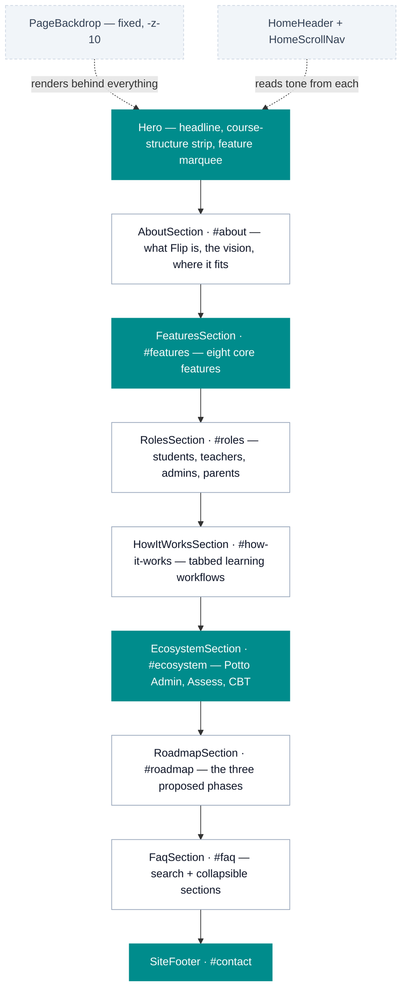
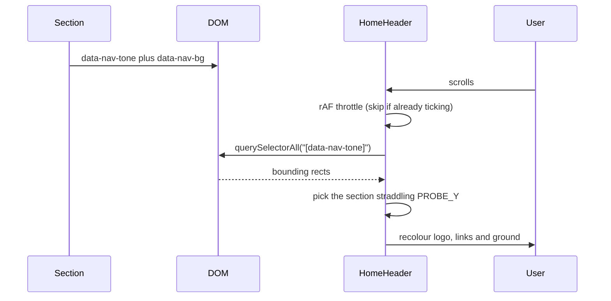
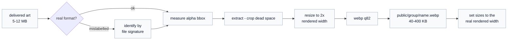

# Potto Flip — marketing site

The public site for **Potto Flip**, the e-learning platform of the Potto
ecosystem: courses, lessons, assignments, practice quizzes, feedback and
learning progress for schools, teachers and students. It is one long homepage,
no other routes.

The content comes from the **Potto Flip PRD**, kept in
[`docs/PRD.md`](docs/PRD.md) — the roles, the core modules, the four learning
workflows, the ecosystem integrations and the phased roadmap. The PRD is a
*proposed* specification, so anything it does not say is a gap for the team,
not a drafting choice (see Known gaps).

The site started as a copy of the Pottolite site and keeps its design system,
header mechanism and section patterns unchanged.

> **Read [`AGENTS.md`](AGENTS.md) before writing code.** This is Next.js **16**,
> whose APIs and conventions differ from older versions. The guides in
> `node_modules/next/dist/docs/` are the authority, not memory or older tutorials.
>
> That file also carries the short list of **project rules** — the things that
> break when they are ignored. This README is the reasoning behind them.

---

## Stack

| Concern | Choice | Notes |
| --- | --- | --- |
| Framework | Next.js 16.3.1, App Router | Turbopack; the homepage prerenders static |
| UI | React 19.2 | the routes are Server Components; the homepage's sections are client components (`"use client"`) |
| Styling | Tailwind CSS v4 | CSS-first config in [`globals.css`](src/app/globals.css) — there is **no** `tailwind.config.js` |
| Animation | framer-motion 13 | scroll reveals, tabs, the FAQ accordion |
| Icons | `@hugeicons/react` + `@hugeicons/core-free-icons` | the house icon set |
| Fonts | Poppins (400/600/700), Geist Mono | via `next/font/google` |

Every remaining dependency is used. `shadcn` and `tw-animate-css` are pulled in
by `globals.css` for their **token vocabulary and utilities only** — no shadcn
component is rendered anywhere, and `src/components/ui/` does not exist. `gsap`
drives the hero marquee and entrance; everything else animates with
framer-motion.

## Quick start

Requires **Node ≥ 20.9**.

```bash
npm install
npm run dev      # http://localhost:3000
npm run build    # production build — run this before every commit
npm run lint     # eslint
npx tsc --noEmit # typecheck (not wired into a script)
```

---

## Routes

| Route | What it is |
| --- | --- |
| `/` | The homepage, prerendered static |

There are no legal pages yet (see Known gaps). Header and footer links are still
root-relative (`/#features`) so they keep working if routes are added later.

---

## Page composition

Sections are composed in [`src/app/page.tsx`](src/app/page.tsx) in this order.
Every section declares a **tone** that drives the header colour (see below).



Teal = dark ground. The header's "Talk to us" and the hero's second button go
to `#contact`, the footer.

### Where the copy comes from

| Section | PRD source |
| --- | --- |
| Hero, About | 1.1 – 1.4, 14 |
| Features | 4.3 – 4.11, 8 (the Phase 1 scope in 10) |
| Who it's for | 3.2 – 3.5. The platform super administrator (3.1) is Potto's own role and is left off |
| How it works | 6.1 – 6.4, step for step |
| Ecosystem | 7, 11 — worded "designed to", because every integration there is still "potential" |
| Roadmap | 10, labelled as proposed priorities |
| FAQ | the above, plus 8 (privacy) and 9 (devices) |

### The "one picture" rule

[`PageBackdrop`](src/components/PageBackdrop.tsx) paints a single fixed canvas
plus a generated contour pattern for the **whole page**. Sections render
transparent on top of it, or paint their own ground when they need one (the teal
bands). The site is meant to read as one continuous image from header to footer —
**avoid boxes, frames and cards floating on visible panels.**

---

## How the header knows what colour to be

There is no scroll-position table. Each section advertises its own tone, and the
header samples whichever section is under a fixed probe line.



**Any new section must declare both attributes**, or the header falls back to the
light default and its links vanish over a dark ground.

```tsx
<section
  id="my-section"
  data-nav-tone="dark"
  data-nav-bg="var(--color-brand-teal-dark)"
  className="relative bg-brand-teal-dark py-24 text-white md:py-32"
>
```

A section only needs an `id` if it is a scroll-nav target or a link target.
If a section ever changes tone without the user scrolling, dispatch a synthetic
`scroll` event so the header re-probes.

---

## Design system

Tokens live in [`globals.css`](src/app/globals.css) under `@theme` (fixed brand
palette) and `@theme inline` (semantic aliases). **Light theme only** —
`color-scheme: light` is declared and there is no dark mode.

| Token | Value | Use |
| --- | --- | --- |
| `--brand` | `#0F766E` | primary teal for text and fills on light; AA with white text |
| `--color-brand-teal` | `#008C8C` | the Potto teal |
| `--color-brand-teal-dark` | `#008C8C` | dark section grounds — see Known gaps on contrast |
| `--color-brand-gold` | `#CA8A04` | CTA fills — **fills only, see below** |
| `--color-brand-yellow-light` | `#FACC15` | accent text on teal |
| `--ink` / `--soft` | `#000000` / `#6B7280` | body text on light |
| `--highlight` | `#FACC15` | marker-pen underline behind accent words |
| `--canvas` / `--surface-2` | white / near-white | page and inset fills |

### Contrast, measured

Gold is a **fill colour, not a text colour on teal**. Real ratios against the
`#0F766E` ground:

| Foreground on teal | Ratio | Verdict |
| --- | --- | --- |
| `brand-gold` `#CA8A04` | **1.86** | unusable |
| `brand-yellow` `#EAB308` | 2.85 | fills only |
| `brand-yellow-light` `#FACC15` | 3.57 | short accents only |
| `text-white/75` | 3.82 | too low for body |
| `text-white/90` | **4.76** | body copy on teal |

For reference, light-theme body text (`#6B7280` on white) is **4.83**, so
`text-white/90` is the teal equivalent. Filled gold tiles are fine — a shape
carries a colour that 14px type cannot.

### Animation

Three custom keyframes are defined inside `@theme`, each reading its colour from
a per-element `--glow` custom property so one animation serves every accent:

- `animate-glow` — breathing box-shadow on CTAs
- `animate-halo` — slow halo behind play buttons
- `animate-pulse-ring` — expanding ring; two, offset in time, read as continuous

Usage: `className="animate-glow [--glow:var(--color-brand-teal)]"`.
A `prefers-reduced-motion` block disables all three.

---

## Shared components

| Component | Role |
| --- | --- |
| [`SectionCaption`](src/components/SectionCaption.tsx) | The centred uppercase eyebrow **every** section opens with. Tone-aware. Use it — do not hand-roll another. |
| [`Wordmark`](src/components/Wordmark.tsx) | The Potto hand plus "Potto Flip" set in type, "Flip" in the accent colour. There is no Flip logo artwork, so the name is live text; `tone="dark"` inverts the mark to white. |
| [`PageBackdrop`](src/components/PageBackdrop.tsx) / [`ContourPattern`](src/components/ContourPattern.tsx) | The single page-wide ground; contour lines are generated in JS, not an asset. |
| [`HomeHeader`](src/components/HomeHeader.tsx) | Tone-adaptive header — see the probe mechanism above. |
| [`HomeScrollNav`](src/components/HomeScrollNav.tsx) | Vertical dot rail, desktop only (`lg:block`), driven by a hand-maintained `SECTIONS` list. |
| [`HowItWorksSection`](src/components/HowItWorksSection.tsx) | WAI-ARIA tabs (arrow keys move between them). Each tab is one PRD workflow: who does it, a one-line note, and its steps. Add one by adding an entry to `FLOWS`. |
| [`WhatsAppButton`](src/components/WhatsAppButton.tsx) | Fixed customer-care link, bottom-right, mounted in `layout.tsx`. A Server Component — it ships no JavaScript. |

### Patterns worth copying

- **Scroll reveal.** Every section defines a local `reveal(delay)` returning
  `initial` / `animate` / `transition`, gated on
  `useInView(ref, { once: true })`, with a shared `ease = [0.22, 1, 0.36, 1]`.
- **Tabs over carousels.** The workflow walkthrough is a tab row, which scrolls
  sideways on phones rather than wrapping, with the panel directly beneath it.
- **No invented interface.** With no Flip screenshots, the hero shows the shape
  of a course (course → modules → lessons → activities → progress) as icons,
  not a mocked-up dashboard.
- **No `setState` inside an effect body.** The `react-hooks/set-state-in-effect`
  rule is enforced as an **error**. For a hydration-time value use
  `useSyncExternalStore` with a never-notifying subscribe (see
  `SiteFooter`); for measurement, let `ResizeObserver` fire on `observe`.

---

## Checking it in a browser

Most sections reveal on scroll (`useInView`), and the FAQ cards fade back out
once scrolled past, so a plain `chrome --headless --screenshot` captures empty
sections. Drive Chrome over the DevTools protocol instead: `npm run build`,
`npx next start`, launch Chrome with `--remote-debugging-port`, set the viewport
with `Emulation.setDeviceMetricsOverride`, scroll the page in steps so every
reveal fires, then `Page.captureScreenshot` with `captureBeyondViewport`. Check
at 1440 px and 390 px, and compare `scrollWidth` with `innerWidth` for horizontal
overflow. Node 20 needs `--experimental-websocket` for the CDP socket.

Stop `next start` before rebuilding; it holds `.next` open.

---

## Assets

`public/` holds **1 file — `potto-mark.webp`**, the Potto hand mark cropped to
its alpha bounding box; it is also the favicon. Keep `public/` to files that are
referenced by exact path: nothing prunes it automatically and everything in it
ships.

When screenshots or photos are added, they follow the pipeline below. Source
art arrives large (5–12 MB PNG/JPG, occasionally with the wrong extension).
Everything on the page is a cropped, resized WebP:



Rules that came out of doing this the hard way:

- **Keep originals out of `public/`.** A `.png` master beside its `.webp` ships
  to every visitor. Masters belong outside the repo, not next to the derivative.
- **Check the file signature, not the extension.** One delivered file was a
  5.7 MB PNG named `.webp`; browsers sniff the bytes, so it renders fine and the
  mistake survives.
- **Crop to the alpha bounding box.** Delivered art is often parked off-centre in
  a larger canvas; `object-contain` centres the *canvas*, so the subject renders
  small and visibly shifted. `trim()` will not help when the margin is
  transparent rather than a solid colour — measure the bbox and `extract`.
- **Match the box to the art's aspect ratio.** A square image in a wide, short
  box fits by height and wastes the width.
- **`sizes` must match the real rendered width.** Overstating it makes Next fetch
  twice the pixels. Compute the grid track width; do not guess with `30vw`.
- **Flatten anything that must be opaque** — a stray alpha channel lets the
  section ground punch through a photo.

---

## Known gaps

Tracked here rather than in code comments so they stay visible. Each is a
decision for the team.

| Gap | Detail |
| --- | --- |
| Product status | The PRD is a *proposed* specification, and says its phases are "not a statement of existing development status". The site describes the Phase 1 core in the present tense and labels Phases 2 and 3 as planned. Confirm Phase 1 is real before launch — or add an "in development" label and change the CTAs to "register interest" |
| Integrations | The PRD lists the Admin, Assess and CBT integrations as *potential*, to be validated against the real services. The Ecosystem section and FAQ say "designed to"; confirm before promising them |
| No privacy policy or terms | Flip processes educational records and may serve children (PRD 8), including consent and parental access. It needs its own notice, written against Nigeria's data protection framework, before launch |
| Pricing | The PRD has no pricing or plans, so the site has none and the FAQ does not answer "how much does it cost?" |
| Screenshots | There are none. The hero shows the course structure as icons instead |
| Team | The Pottolite team section was removed — those people and photos were for Pottolite. Add a Flip team only with names, photos and consent from the people in it |
| Contacts | The footer keeps Potto's address, phone lines, emails and office hours, and support points to `support@potto.ng`. The WhatsApp button still opens Potto's customer-care line, `wa.me/2349064566528` — confirm it handles Flip |
| Sign-up | There is no Flip sign-up or app URL, so every CTA goes to the contact details |
| Teal contrast | `--color-brand-teal-dark` is `#008C8C`, not the `#0F766E` the contrast table above was measured on. White on `#008C8C` is about 4.1:1 — below AA for body text. Darkening it would fix this at the cost of matching the Potto teal |
| Scroll-nav order | `HomeScrollNav`'s `SECTIONS` list is hand-maintained and **must stay in `page.tsx` order** |
| FAQ search | Plain substring matching, no stemming |
